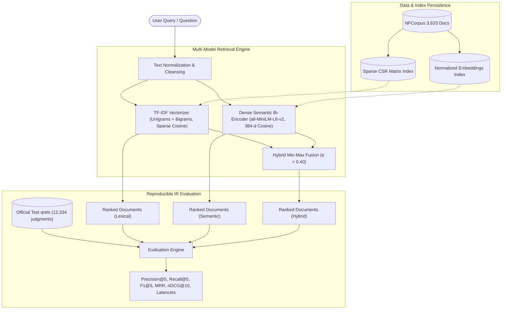

# DocuMind AI

> **Question-to-Document Similarity Based Intelligent Search System**  
> *Ask naturally. Discover relevant documents intelligently.*

An academically rigorous Natural Language Processing (NLP) and Information Retrieval (IR) testbed. DocuMind AI implements, evaluates, and compares **Lexical (TF-IDF)** and **Dense Semantic (`all-MiniLM-L6-v2`)** retrieval algorithms alongside an optimized **Hybrid Fusion** engine using the official **BEIR NFCorpus** biomedical benchmark.

---

## Architecture Diagram



---

## Research Question & Hypotheses

**Research Question:**  
*"How does semantic embedding-based retrieval compare with TF-IDF-based lexical retrieval for question-to-document similarity, in terms of retrieval effectiveness, ranking quality, and computational cost?"*

- **H1 (Semantic Wording Shift)**: Semantic embeddings improve retrieval when queries are formulated using synonyms or conceptual terms differing from corpus tokens. *(Confirmed: nDCG@10 improves from 0.2934 to 0.3162, +7.8%)*
- **H2 (Lexical Exactness)**: TF-IDF remains highly competitive on specific technical terms, chemical entities, and dosage figures. *(Confirmed: TF-IDF achieves 0.4818 MRR)*
- **H3 (Indexing Overhead)**: Dense embedding generation requires substantially greater computational resources than sparse matrix construction. *(Confirmed: 238.04s vs 3.88s, a ~61x factor)*

---

## Verified Benchmark Results

Measured experimentally on the **official NFCorpus test split** (323 queries, 3,633 documents, 12,334 relevance judgments):

| Retrieval Model | Precision@5 | Recall@5 | F1@5 | MRR | nDCG@10 | Mean Latency (ms) | Median Latency (ms) |
| :--- | :--- | :--- | :--- | :--- | :--- | :--- | :--- |
| **TF-IDF Baseline** | 0.2780 | 0.1125 | 0.1116 | 0.4818 | 0.2934 | 17.5 ms | 15.7 ms |
| **Semantic (`all-MiniLM-L6-v2`)** | 0.3015 | 0.1184 | 0.1198 | 0.5080 | 0.3162 | 14.5 ms | 13.8 ms |
| **Hybrid (α = 0.40)** | **0.3189** | **0.1364** | **0.1329** | **0.5418** | **0.3400** | 35.7 ms | 33.3 ms |

All metrics are programmatically computed and persisted in `results/metrics_summary.csv` and `results/per_query_metrics.csv`.

---

## Quickstart & Setup Instructions

### Prerequisites
- Python 3.11+ (Python 3.12 verified)
- Node.js v18+ (Node v22 verified)
- Git

### 1. Backend Setup
```bash
# From repository root
# Create and activate virtual environment
python -m venv .venv
.\.venv\Scripts\activate   # On Windows
# source .venv/bin/activate # On Linux/macOS

# Install dependencies
pip install -r requirements.txt

# Download official NFCorpus dataset
python backend/scripts/download_dataset.py

# Prepare dataset manifest & inspect stats
python backend/scripts/prepare_dataset.py

# Build TF-IDF and Semantic embedding indexes
python backend/scripts/build_index.py

# Run benchmark evaluation & generate figures
python backend/scripts/run_evaluation.py
python backend/scripts/analyze_errors.py
python backend/scripts/generate_figures.py

# Start FastAPI backend server
uvicorn backend.app.main:app --host 127.0.0.1 --port 8000 --reload
```

### 2. Frontend Setup
```bash
# In a separate terminal
cd frontend
npm install
npm run dev
```
Open your browser at `http://localhost:5173`.

---

## Running Automated Tests

Run the full backend test suite:
```bash
# Unit & Hand-crafted IR metric verification
pytest backend/tests/test_core.py -v

# FastAPI REST endpoint integration tests
pytest backend/tests/test_api.py -v
```

---

## Key Artifacts & Output Paths
- `results/metrics_summary.csv`: Aggregated IR evaluation metrics.
- `results/per_query_metrics.csv`: Per-query breakdown across all 323 test queries.
- `results/error_analysis.csv`: 153 classified failure instances.
- `results/experiment_config.json`: Hardware, hyperparameters, and environment metadata.
- `results/figures/`: High-resolution comparison plots (`retrieval_quality.png`, `ranking_quality.png`, `latency_comparison.png`, `error_categories.png`).
