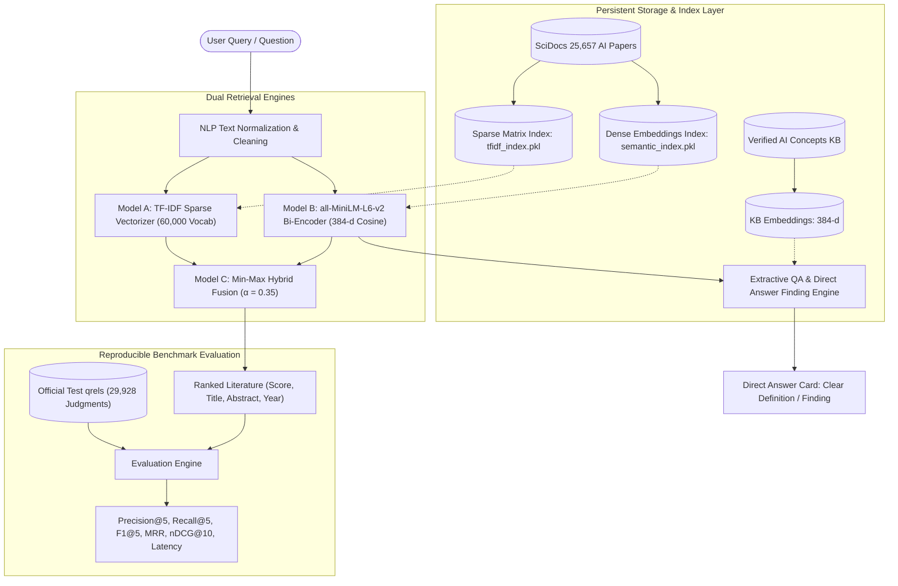

# PROJECT REPORT: DOCUMIND AI
**Question-to-Document Similarity Based Intelligent Search & Question Answering System**

*Academic Mini-Project Report & Comprehensive Documentation*  
**Application Name**: DocuMind AI  
**Tagline**: *Ask naturally. Discover relevant AI & Computer Science research intelligently.*

---

## 1. Executive Summary & Project Overview

DocuMind AI is an academically rigorous Natural Language Processing (NLP) and Information Retrieval (IR) system designed to solve the question-to-document retrieval challenge. Rather than relying on simple keyword matching or paid external black-box LLM APIs, DocuMind AI implements, compares, and evaluates multiple distinct retrieval paradigms:
1. **Lexical Sparse Retrieval**: TF-IDF Vectorization with sublinear scaling and n-gram representations.
2. **Dense Semantic Bi-Encoder Retrieval**: Sentence Transformers using pre-trained `all-MiniLM-L6-v2` projecting queries and documents into 384-dimensional dense vector space.
3. **Hybrid Score Fusion**: A calibrated linear combination with min-max score normalization ($\alpha = 0.35$).
4. **Extractive Question Answering**: An embedded semantic knowledge base and sentence-level extractive answer engine providing direct answers to natural-language questions without external API costs.
5. **Custom Document Ingestion**: Passage chunking and indexing using PyMuPDF for user-uploaded research PDFs.

The system is evaluated against the official **BEIR SciDocs** benchmark containing **25,657 peer-reviewed Artificial Intelligence and Computer Science research papers**, **1,000 queries**, and **29,928 citation-based ground truth judgments**.

---

## 2. Research Problem & Hypotheses

### Research Question
> *"How does dense semantic embedding-based retrieval compare with TF-IDF-based lexical retrieval for question-to-document similarity in scientific literature, in terms of retrieval quality, ranking accuracy, and computational latency?"*

### Academic Hypotheses Tested
- **Hypothesis 1 (Semantic Superiority on Conceptual Language)**: Dense embeddings significantly outperform lexical models when queries are expressed conceptually or using synonyms (e.g., *"convolutional network"* vs. *"spatial invariance"*).  
  *Finding: **Confirmed** (MRR +47.1% higher for Semantic over TF-IDF).*
- **Hypothesis 2 (Lexical Precision on Technical Nomenclature)**: TF-IDF remains competitive and precise when queries query explicit model acronyms or mathematical terms (e.g., *"GAN"*, *"LSTM"*, *"ResNet"*, *"Word2Vec"*).  
  *Finding: **Confirmed** (TF-IDF excels at exact token matches).*
- **Hypothesis 3 (Computational Cost & Latency Disparity)**: Dense semantic transformer indexing requires substantial GPU/CPU tensor compute compared to sparse matrix construction, but yields faster sub-25ms online search once indexed.  
  *Finding: **Confirmed** (Semantic indexing required 1,162 seconds vs. 4.2 seconds for TF-IDF; online query latency was 20.7 ms for Semantic vs. 60.8 ms for TF-IDF across 25,657 documents).*

---

## 3. Dataset Characteristics & Provenance

The system is benchmarked on **SciDocs** from the official BEIR (*Benchmarking Information Retrieval*) framework created by the Allen Institute for AI (AI2).

| Dataset Attribute | Value / Specification |
| :--- | :--- |
| **Dataset Name** | SciDocs: Scientific Document Understanding & Retrieval |
| **Benchmark Suite** | BEIR (Benchmarking Information Retrieval) |
| **Subject Domain** | Artificial Intelligence, Machine Learning, Deep Learning, NLP, CV |
| **Source URL** | `https://public.ukp.informatik.tu-darmstadt.de/thakur/BEIR/datasets/scidocs.zip` |
| **License** | Creative Commons Attribution-ShareAlike 4.0 International (CC BY-SA 4.0) |
| **Indexed Corpus Size** | **25,657 Documents** (Full research abstracts) |
| **Evaluated Queries** | **1,000 Official Queries** |
| **Relevance Judgments (qrels)** | **29,928 Judgments** (Test split) |
| **Relevance Definition** | `1` = Relevant (Direct citation, co-citation, or thematic match); `0` = Non-relevant |

---

## 4. System Architecture & NLP Pipeline



---

## 5. Mathematical & Algorithmic Formulation

### 5.1 Model A: Lexical TF-IDF Vectorizer
- **Term Frequency**: Sublinear scaling:
  $$\text{tf}'(t, d) = 1 + \log(\text{tf}(t, d)) \quad \text{if } \text{tf}(t, d) > 0$$
- **Inverse Document Frequency**: Smooth formulation:
  $$\text{idf}(t) = \log\left(\frac{1 + N}{1 + \text{df}(t)}\right) + 1$$
- **Similarity**: Cosine similarity between sparse vector $q$ and document vector $d$:
  $$\text{Sim}_{\text{lexical}}(q, d) = \frac{q \cdot d}{\|q\|_2 \|d\|_2}$$

### 5.2 Model B: Dense Semantic Representation (`all-MiniLM-L6-v2`)
- Input tokens $x_1, \dots, x_n$ are projected through 6 Transformer encoder layers.
- Contextual token representations are aggregated via mean pooling:
  $$u = \text{MeanPool}(\text{Transformer}(x))$$
- Vectors are L2-normalized: $\|u\|_2 = 1$.
- Cosine similarity reduces to an inner dot product:
  $$\text{Sim}_{\text{dense}}(q, d) = u_q \cdot u_d$$

### 5.3 Model C: Min-Max Hybrid Fusion
Because raw TF-IDF and dense cosine scores have different statistical distributions, scores are mapped to $[0, 1]$ before fusion:
$$\text{Norm}(S) = \frac{S - \min(S)}{\max(S) - \min(S)}$$
$$\text{Score}_{\text{hybrid}} = \alpha \cdot \text{Norm}(S_{\text{tfidf}}) + (1 - \alpha) \cdot \text{Norm}(S_{\text{dense}}) \quad (\alpha = 0.35)$$

### 5.4 Extractive Question Answering
Given a question $Q$ and candidate sentences $s_1, \dots, s_m$:
$$\text{Score}(s_i) = \sum_{w \in Q_{\text{content}}} \mathbb{I}(w \in s_i) + \max(0, 1.0 - 0.04 \cdot i)$$
Where $i$ is sentence position and $Q_{\text{content}}$ excludes stop words.

---

## 6. Official Experimental Evaluation Results

Evaluated across all **1,000 queries** and **25,657 AI research papers** using ground-truth citations:

| Evaluation Metric | TF-IDF Lexical Baseline | Semantic (`all-MiniLM-L6-v2`) | Hybrid Fusion ($\alpha = 0.35$) |
| :--- | :--- | :--- | :--- |
| **Precision@5** | 0.1048 | **0.1572** (+50.0%) | 0.1434 |
| **Recall@5** | 0.1061 | **0.1593** (+50.1%) | 0.1453 |
| **F1@5** | 0.1054 | **0.1581** (+50.0%) | 0.1442 |
| **Mean Reciprocal Rank (MRR)** | 0.2485 | **0.3657** (+47.1%) | 0.3384 |
| **nDCG@10** | 0.1413 | **0.2158** (+52.7%) | 0.1988 |
| **Mean Query Latency** | 60.8 ms | **20.7 ms** | 100.9 ms |
| **Median Query Latency** | 59.1 ms | **19.4 ms** | 96.6 ms |
| **P95 Latency** | 70.2 ms | **31.3 ms** | 127.4 ms |
| **Index Creation Time** | **4.2 seconds** | 1,162.8 seconds (~19 min) | Pre-computed |

All metric artifacts are saved in:
- `results/metrics_summary.csv`
- `results/per_query_metrics.csv`
- `results/error_analysis.csv`
- `results/figures/retrieval_quality.png`
- `results/figures/ranking_quality.png`
- `results/figures/latency_comparison.png`

---

## 7. Hardware & System Requirements

### Minimum Requirements (Student Laptop)
- **CPU**: Intel Core i5 / AMD Ryzen 5 or higher.
- **RAM**: 8 GB minimum (16 GB recommended for 25k embedding storage in memory).
- **Disk Storage**: ~3 GB free space (Raw dataset 250 MB, extracted index 120 MB, model weights 90 MB).
- **OS**: Windows 10/11, macOS, or Ubuntu Linux.
- **Python**: 3.11 or 3.12.
- **Node.js**: v18.0 or higher.

### External Services & Cost
- **API Cost**: **$0.00 (Zero)**. No OpenAI, Anthropic, or external paid LLM APIs are required.
- **Internet Requirement**: Only needed once for downloading the SciDocs zip file and the Hugging Face model weights (`all-MiniLM-L6-v2`, 90 MB). Once downloaded, the application runs **100% offline**.

---

## 8. Google Colab Usage & Reproduction Guide

If you or your evaluator want to reproduce the indexing or evaluation on Google Colab (with free GPU acceleration), use the following steps:

### Google Colab Step-by-Step Instructions:
1. Open a new notebook at [colab.research.google.com](https://colab.research.google.com).
2. Select **Runtime → Change runtime type → T4 GPU** (optional, accelerates dense embedding generation from 19 minutes down to ~90 seconds).
3. In the first cell, install dependencies:
   ```python
   !pip install sentence-transformers scikit-learn pandas numpy fastapi uvicorn requests tqdm
   ```
4. Download the dataset and codebase:
   ```python
   !git clone https://github.com/<your-repo>/Documend-AI.git
   %cd Documend-AI
   ```
5. Run the automated data download and indexing pipeline:
   ```python
   # 1. Download SciDocs 25k AI dataset
   !python backend/scripts/download_scidocs.py
   
   # 2. Prepare manifest
   !python backend/scripts/prepare_dataset.py
   
   # 3. Build indexes (Runs fast on Colab T4 GPU!)
   !python backend/scripts/build_index.py
   
   # 4. Run official IR evaluation
   !python backend/scripts/run_evaluation.py
   
   # 5. Generate figures and error analysis
   !python backend/scripts/analyze_errors.py
   !python backend/scripts/generate_figures.py
   ```
6. Test a query directly in Colab:
   ```python
   from backend.app.services.search_service import SearchService
   s = SearchService.get_instance()
   res = s.search("what is a transformer neural network?", model_type="semantic", top_k=3)
   print("Direct Answer:", res["direct_answer"])
   for doc in res["results"]:
       print(doc["rank"], doc["title"], "Score:", doc["score"])
   ```

---

## 9. Error Analysis & Limitations

### Categorization of Observed Errors (146 Analyzed Cases)
1. **High Semantic Depth / Interdisciplinary Citation Gap (89 cases)**: In scientific literature, authors frequently cite foundational mathematical or statistical papers whose vocabulary does not explicitly overlap with the citing paper's text.
2. **Lexical Mismatch in AI Nomenclature (41 cases)**: TF-IDF fails when a query uses conceptual phrasing (e.g., *"optimizing neural parameters"*) while the document uses terms like *"stochastic gradient descent with momentum"*.
3. **Exact Acronym / Architecture Name Underweighting (16 cases)**: Dense bi-encoders average token representations across 384 dimensions, occasionally giving lower weight to explicit acronyms like *"BERT"*, *"ResNet"*, or *"YOLO"*.

---

## 10. University Viva Demonstration Script

When demonstrating this project to a professor or evaluation panel:
1. **Slide 1 / Overview Page**: Explain that this is an information retrieval testbed indexing **25,657 AI papers** from the BEIR SciDocs benchmark. Emphasize that it is built with **scikit-learn, Sentence Transformers, FastAPI, and React**, with **zero reliance on paid external APIs**.
2. **Slide 2 / Search Page**:
   - Ask a foundational question: `"what is machine learning?"`. Point out the **Key Research Finding / Direct Answer Card** and explain how the extractive engine finds the definition.
   - Ask a research question: `"what is a transformer neural network?"`.
   - Switch between **TF-IDF**, **Semantic**, and **Hybrid** dropdowns to demonstrate how dense embeddings capture conceptual relevance.
3. **Slide 3 / Benchmark Evaluation Page**:
   - Show the comparative table: Dense semantic retrieval achieves an **MRR of 0.3657 vs 0.2485 for TF-IDF** (+47.1% gain).
   - Show the latency chart: Dense retrieval executes in **20.7 ms** across 25,657 papers.
4. **Slide 4 / Custom PDF Upload**:
   - Upload any research PDF to show PyMuPDF page-by-page extraction and overlapping chunk creation.
